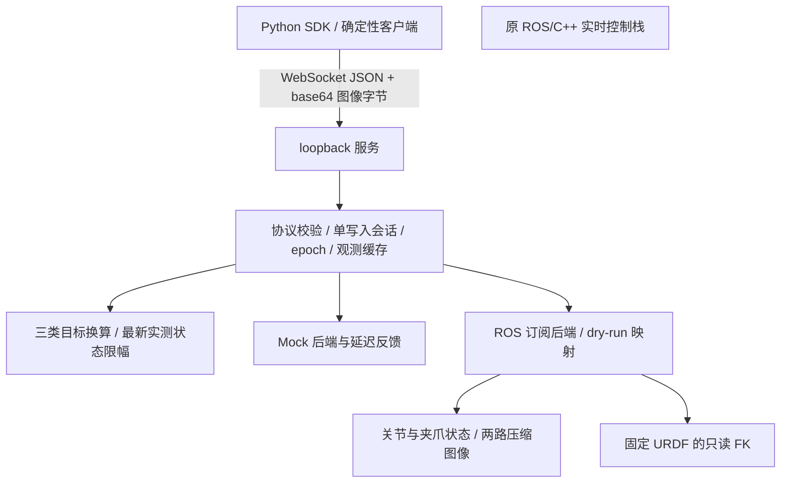

# 架构与边界

真实 ROS 后端目前没有连向底层执行器的写入路径。网络服务与 Python SDK 不承担实时控制。后续执行适配必须继续使用已核实的 C++ 控制链路，并有不依赖网络服务存活的超时处理。

## 代码

| 模块 | 职责 |
| --- | --- |
| `protocol.py` | JSON、有限数、版本、错误码和字段校验 |
| `transforms.py` | xyzw 四元数、基座增量、非零 TCP 偏移映射 |
| `validation.py` | 显式动作类型、配置范围、最新实测状态与目标差异 |
| `core.py` | 观测编号、单写入者、epoch、幂等、命令状态与超时 |
| `server.py` | 一种传输：WebSocket；独立看门狗任务、断线处理、轮转日志 |
| `client.py` | 本地与 SSH 转发远端共用的异步 SDK、心跳、响应关联 |
| `backends/mock.py` | 可控延迟与失败条件；不模拟机器人动力学 |
| `backends/ros2.py` | 独立 ROS 订阅线程，禁止创建控制发布者及 action client |
| `backends/ros_mapping.py` | 关节按名称重排；只输出拟发布消息结构 |
| `kinematics.py` | 按安装的展开 URDF 计算工具姿态；不做 IK |

Mock 导入不导入 ROS、PyTorch 或任何模型包。构建工具与网络依赖固定在独立包中，ROS 的实际依赖清单单独采集。

## 观测与内存

ROS 回调缓存已经编码的 JPEG/PNG 字节及来源时间戳。每次请求生成新的随机 `observation_id` 和服务端单调时刻，复制当时的状态。最多保存 256 个观测；超出缓存或过期的引用都拒绝。参考传感器年龄会随着服务端时间继续增长，而不是冻结在取观测时。

`robot_only` 不读取相机；`dual_camera` 必须得到配置的两路相机，失联、过期、时间差过大分别可诊断。采用最近收到的样本，报告 ROS 原始时间戳差；这没有提供硬件同步保证。原始时间戳将来于本地 ROS 时钟时也不会直接当作新鲜数据。

图像在网络中以 base64 携带真实编码字节，远端不依赖控制电脑文件路径。Mock 图像明确标记 `source=mock`。默认日志不保存原始图像；`read_only_client.py --output` 才显式保存一次图像样本。

## 写入生命周期

连接只取得读取能力。`acquire_control` 把随机会话绑定到当前连接，其他连接即使知道 session ID 也不能写。SDK 心跳刷新服务端租约；服务端在每次处理请求前和独立周期任务中检查过期。

重新取得控制权、切换模式、停止、故障、断线均使 epoch 前进并失效旧观测。模式必须显式选取。Mock 切换先停止并中止活动目标，再确认后端切换结果；dry-run 只改变虚拟模式，不调用 ROS 服务。

v1 不排队，活动目标未结束时返回 `COMMAND_IN_PROGRESS`。相同 ID 和相同信封返回已有命令状态；不同内容使用相同 ID 返回冲突。每个参考观测只能被一条相对动作消费。每会话最多保留 4096 个请求，达到容量后要求显式释放并重新取得会话，不悄悄淘汰幂等记录。新会话不恢复旧命令。

`accepted` 只表示后端接收；Mock 下一周期可进入 `executing`，按反馈误差进入 `completed`，不收敛或缺失反馈会进入 `aborted`。dry-run 保持 `validated`。故障后需显式释放、重新获取和选模式；没有自动恢复并重放。

## 实时、停止与部署边界

WebSocket 最大请求为 512 KiB、有限队列，发送有超时，watchdog 与每条网络响应分开调度。SDK 超时会关闭连接，避免迟到响应被下一条 RPC 误认；不自动重试动作。

这些机制只约束本服务内的 Mock / dry-run。Python 服务被杀后不能保证现有真机控制器停止，因此 `real + execute` 在配置阶段直接拒绝。现有 C++ `stop_commands` 只是跳过本次写值，未被证明是硬件停止；`on_deactivate` 也未给出保持程序。不得称软件 `stop()` 为硬件急停。

平台 lease 不能隔离外部 ROS 发布者。真机执行前仍需检查目标话题其他发布源、控制器资源、独立超时程序和当前底层二进制版本。

日志采用 2 MiB × 4 个文件的轮转，关联 session、request、observation、epoch、类型、换算目标、后端、权限和状态。内存中的状态在服务重启后不恢复；旧 session 和 observation 随机编号不会在新进程中继续生效。
